# 👑 MicroOS: Dual-OS Engineering Project & Workload-Aware Scheduling Lab

[](https://www.debian.org/)
[](https://www.rust-lang.org/)
[-0078D4?logo=windows11&logoColor=white)](https://xfce.org/)
[](docs/BOOT_BENCHMARKS.md)
[](LICENSE)

---

## 🎓 Academic Credentials & Author Information

- **Candidate**: **Yeddula Vyshnavi**
- **University Serial Number (USN)**: **25BTRCL294**
- **Section**: **E**
- **Course**: **25PCCS201: Operating Systems Research Activity**
- **Institution**: **Faculty of Engineering and Technology (FET), JAIN (Deemed-to-be University)**
- **Research Topic**: **Workload-Aware Scheduling: Can workload characteristics be used to select a more suitable scheduling strategy?**

---

## 🌟 Project Architecture & System Overview

This repository represents a complete, production-grade Dual-Operating System Engineering Project combining two complementary operating systems and an integrated academic research laboratory:

```mermaid
graph TD
    ROOT["Dual-OS Engineering Project (MicroOS)"] --> SUB1["1. Debian MicroOS (Live Linux Distribution)"]
    ROOT --> SUB2["2. RustOS (Bare-Metal 32-bit x86 Kernel)"]
    ROOT --> SUB3["3. Workload-Aware Research Lab (Benchmark Suite)"]
    ROOT --> SUB4["4. 1-Click VM Launchers & Academic Docs"]

    SUB1 --> S1_A["<450 MB Live Hybrid ISO (SquashFS XZ)"]
    SUB1 --> S1_B["Windows 11-Style GUI (XFCE4 + Whisker Menu)"]
    SUB1 --> S1_C["LightDM Automated Autologin (user:user)"]
    SUB1 --> S1_D["Retro Arcade Suite (Snake & 2048)"]

    SUB2 --> S2_A["Freestanding Rust (#![no_std], #![no_main])"]
    SUB2 --> S2_B["Custom GDT, IDT (256 Gates), 8259 PIC Remap"]
    SUB2 --> S2_C["8254 PIT Timer (100 Hz) + PS/2 Keyboard Driver"]
    SUB2 --> S2_D["VGA 80x25 MMIO Driver + In-Kernel Shell"]

    SUB3 --> S3_A["Python 3.12 Simulator (/usr/local/bin/sched_sim.py)"]
    SUB3 --> S3_B["High-Performance Rust Binary (/usr/local/bin/research-lab)"]
    SUB3 --> S3_C["5 Workloads (Uniform, Short, Bimodal, Heavy, Batch)"]
    SUB3 --> S3_D["Evaluates FCFS, SJF, SRTF, RR vs. WA Selector"]

    SUB4 --> S4_A["Start-MicroOS.bat (1-Click VirtualBox Auto-Provisioner)"]
    SUB4 --> S4_B["Run-QEMU.bat (Ultra-Fast Zero-Install Runner)"]
    SUB4 --> S4_C["docs/RESEARCH_PAPER_ANALYSIS.md & PRESENTATION_GUIDE.md"]
```



---

## 🔬 Academic Research Summary: Workload-Aware Scheduling

### The Core Problem
Traditional operating system dispatchers enforce static CPU scheduling policies:
- **FCFS**: Non-preemptive, zero scheduling overhead, but crippled by the **convoy effect** under variable workloads.
- **SJF**: Optimal average waiting time, but risks severe starvation and requires exact future burst lengths.
- **SRTF**: Optimal dynamic waiting time, but imposes significant **context-switch thrashing**.
- **Round Robin (RR, $q=10$)**: Exceptional responsiveness, but worst average waiting and turnaround times under bursty loads.

### The Workload-Aware (WA) Decision Engine
Rather than relying on computationally heavy machine learning models (SVMs/Neural Networks) or prospective online simulations, our selector utilizes two zero-overhead statistical features:
1. **Coefficient of Variation ($CV = \frac{\sigma}{\mu}$)**: Normalized metric of burst variability.
2. **Arrival Pattern ($\text{load}$)**: Distinguishes Poisson streaming arrivals ($\rho = 0.8$) from batch concurrency ($t=0, \text{load} = \infty$).

```
Decision Rules:
├── Rule 1: If CV < 0.5                      ==> Select FCFS (Low variance; avoid switch penalty)
├── Rule 2: Else if Batch and CV < 1.5       ==> Select SJF  (Size-aware; preemption unnecessary)
└── Rule 3: Otherwise                        ==> Select SRTF (High burst skew strongly favors short jobs)
```

### Key Experimental Findings (30 Runs × 200 Jobs × 5 Workloads)

| Workload Profile | Burst $CV$ | FCFS Wait | SJF Wait | SRTF Wait | RR ($q=10$) Wait | **WA Selector Wait** | **Reduction vs. FCFS** |
| :--- | :---: | :---: | :---: | :---: | :---: | :---: | :---: |
| **Uniform** | 0.12 | 25.00 | 22.76 | 23.10 | 41.93 | **25.00** | 0.0% (Tied) |
| **Short** | 0.99 | 25.61 | 12.33 | 12.25 | 28.59 | **12.25** | **+52.2%** |
| **Bimodal** | 2.34 | 160.81 | 63.09 | 23.10 | 65.66 | **23.10** | **+85.6%** |
| **Heavy** | 1.65 | 41.97 | 22.52 | 15.10 | 27.73 | **15.10** | **+64.0%** |
| **Batch** | 1.00 | 1987.94 | 1012.31 | 1012.31 | 2059.44 | **1012.31** | **+49.1%** |

- **Context Switch Efficiency**: In batch workloads, our selector chose **SJF**, strictly keeping context switches at **199**, while Round Robin wasted **498.9 switches** with zero waiting time benefit!
- Complete research paper analysis is documented in [`docs/RESEARCH_PAPER_ANALYSIS.md`](docs/RESEARCH_PAPER_ANALYSIS.md).

---

## ⚡ 1-Click Launchers (VirtualBox & QEMU)

### 1. Windows 1-Click VirtualBox Launcher (`Start-MicroOS.bat`)
Simply double-click [`Start-MicroOS.bat`](Start-MicroOS.bat) in Windows Explorer. The automated script will:
1. Automatically discover `VBoxManage.exe` on your system.
2. Automatically register a 64-bit Debian VM named `MicroOS-Vyshnavi`.
3. Configure 2048 MB RAM, 2 CPU cores, 64 MB VRAM, VBoxSVGA graphics, and an IDE storage controller.
4. Mount `micro-os.iso` and launch the VM directly into a focused window!

### 2. Fast QEMU Runner (`Run-QEMU.bat`)
Double-click [`Run-QEMU.bat`](Run-QEMU.bat) for zero-install, instantaneous virtual hardware execution.

---

## 🏗️ Building Debian MicroOS (<450 MB ISO)

The complete build pipeline is automated via [`micro-os/build_clean.sh`](micro-os/build_clean.sh):

```bash
# Execute within a Debian 12 / Ubuntu environment or WSL 2:
cd micro-os
sudo bash build_clean.sh
```

### Build Pipeline Stages:
1. **Bootstrap**: Deploys minimal Debian 12 Bookworm amd64 rootfs (`debootstrap --variant=minbase`).
2. **Chroot Environment**: Mounts `/dev`, `/proc`, `/sys`, and `/dev/pts`.
3. **Core Packages**: Installs `linux-image-amd64`, `live-boot`, `xfce4`, `lightdm`, `nsnake`, and `python3`.
4. **Windows GUI Styling**: Configures Whisker Menu, Windows 11 style panel, and auto-login for `user:user`.
5. **Research Lab Integration**: Installs `/usr/local/bin/research-lab` and desktop shortcuts.
6. **Device Node Preservation**: Preserves static `/dev/console` and `/dev/null` nodes to avoid boot panics.
7. **SquashFS & ISO Generation**: Creates XZ-compressed SquashFS and authors an ISOLINUX hybrid MBR ISO.

---

## 🦀 Building RustOS Bare-Metal Kernel

RustOS is a freestanding 32-bit x86 kernel with zero external C dependencies located in [`rustos/`](rustos/):

```bash
# Windows:
cd rustos
build.bat

# Linux / Unix:
cd rustos
bash build.sh
```

### Running RustOS in QEMU:
```bash
qemu-system-i386 -kernel target/i686-rustos/release/rustos -vga std
```

### Interactive Kernel Shell Commands:
- `help`: Lists all available kernel commands.
- `info`: Displays candidate credentials, system architecture, GDT/IDT/PIC status.
- `clear`: Clears the VGA text buffer and resets cursor to (0, 0).
- `sched`: **Executes the Workload-Aware CPU Scheduling Benchmark directly inside bare-metal kernel space!**
- `ticks`: Displays 8254 PIT timer ticks and elapsed uptime in seconds.
- `snake`: Plays a mini in-kernel retro arcade simulation.
- `reboot`: Triggers a soft reboot via the 8042 PS/2 controller (`outb(0x64, 0xFE)`).
- `halt`: Halts the CPU via `cli; hlt`.

---

## 📚 Complete Project Documentation Directory

| Document | Description |
| :--- | :--- |
| **[`docs/RESEARCH_PAPER_ANALYSIS.md`](docs/RESEARCH_PAPER_ANALYSIS.md)** | Full academic paper documentation, literature review, mathematical modeling, and Tables 1–6 analysis. |
| **[`docs/PRESENTATION_GUIDE.md`](docs/PRESENTATION_GUIDE.md)** | 10-minute presentation script, slide-by-slide guide, and top 20 anticipated tough viva Q&A. |
| **[`docs/BOOT_BENCHMARKS.md`](docs/BOOT_BENCHMARKS.md)** | Boot timelines, systemd-analyze profiling, RAM footprint (<450 MB), and SquashFS compression statistics. |
| **[`docs/HARDWARE_COMPATIBILITY.md`](docs/HARDWARE_COMPATIBILITY.md)** | VirtualBox / VMware / QEMU hypervisor matrix and bare-metal USB flashing guide. |

---

## 📂 Repository File Tree

```
Micro OS/
├── .gitignore                      # Strictly excludes >100 MB files (*.iso, *.vdi, target/)
├── README.md                       # Master project overview & academic documentation
├── Start-MicroOS.bat               # Automated 1-Click VirtualBox provisioner & launcher
├── Run-QEMU.bat                    # Automated 1-Click QEMU emulator launcher
├── docs/
│   ├── RESEARCH_PAPER_ANALYSIS.md  # Comprehensive research paper report (Yeddula Vyshnavi)
│   ├── PRESENTATION_GUIDE.md       # Viva voce presentation script & top 20 examiner Q&A
│   ├── BOOT_BENCHMARKS.md          # Boot timeline and <450 MB memory optimization metrics
│   └── HARDWARE_COMPATIBILITY.md   # Hypervisor and bare-metal hardware compatibility matrix
├── micro-os/
│   ├── build_clean.sh              # Headless Debian 12 Bookworm Live ISO build automation
│   ├── config/                     # Desktop entries, autologin, and styling configs
│   │   ├── snake.desktop
│   │   ├── 2048-arcade.desktop
│   │   └── research-lab.desktop
│   └── research-lab/               # Academic Research Lab Suite
│       ├── Cargo.toml              # Rust benchmark manifest
│       ├── sched_sim.py            # Python 3 discrete-event simulator (Paper Listing 1)
│       └── src/
│           └── main.rs             # High-performance compiled Rust benchmark binary
└── rustos/                         # Freestanding 32-bit x86 Bare-Metal Kernel
    ├── Cargo.toml                  # Kernel package manifest
    ├── i686-rustos.json            # 32-bit x86 freestanding target specification
    ├── linker.ld                   # 1MB Multiboot linker script
    ├── build.bat                   # Windows kernel build automation
    ├── build.sh                    # Linux kernel build automation
    └── src/
        ├── main.rs                 # Multiboot header, kernel_main, and initialization
        ├── ports.rs                # Hardware Port I/O (inb, outb, inw, outw, io_wait)
        ├── vga_buffer.rs           # 80x25 VGA MMIO driver with hardware cursor
        ├── gdt.rs                  # 32-bit Global Descriptor Table (4GB flat model)
        ├── pic.rs                  # Dual 8259 PIC remapping (IRQ 0..15 -> INT 32..47)
        ├── interrupts.rs           # 256-gate IDT with CPU exceptions & hardware IRQ ISRs
        ├── timer.rs                # 8254 PIT timer driver (100 Hz frequency)
        ├── keyboard.rs             # PS/2 keyboard controller & scancode decoder
        ├── sched_demo.rs           # In-kernel bare-metal Workload-Aware CPU benchmark
        └── shell.rs                # Interactive kernel shell & mini arcade console
```

---

## ⚖️ License & Integrity Statement

This project was developed for the **25PCCS201: Operating Systems Research Activity** at **Faculty of Engineering and Technology, JAIN (Deemed-to-be University)** by **Yeddula Vyshnavi** (USN: 25BTRCL294). All synthetic benchmark results are deterministic, reproducible, and released under the academic MIT License.
