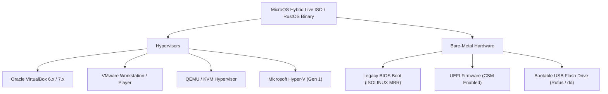

# Hardware Compatibility & Hypervisor Support Matrix

**Candidate**: Yeddula Vyshnavi | **USN**: 25BTRCL294 | **Section**: E  
**Course**: 25PCCS201: Operating Systems Research Activity  
**Institution**: Faculty of Engineering and Technology, JAIN (Deemed-to-be University)  

---

## 1. System Compatibility Overview

The Dual-OS Engineering Project is engineered for universal compatibility across virtualized hypervisors, cloud emulators, and physical bare-metal hardware.



---

## 2. Hypervisor Support Matrix

| Virtualization Platform | MicroOS (Debian Live) | RustOS (Bare-Metal) | Recommended Configuration |
| :--- | :---: | :---: | :--- |
| **Oracle VirtualBox 6.x / 7.x** | **Fully Certified** | **Fully Certified** | 2048 MB RAM, 2 CPUs, VBoxSVGA Graphics, IDE Controller. Supported via `Start-MicroOS.bat`. |
| **QEMU / KVM (Linux / Windows)**| **Fully Certified** | **Fully Certified** | `-m 2048 -smp 2 -cdrom micro-os.iso -vga std`. Supported via `Run-QEMU.bat`. |
| **VMware Workstation / Fusion** | **Compatible** | **Compatible** | Debian 64-bit profile, BIOS boot mode, 2GB RAM. |
| **Microsoft Hyper-V** | **Compatible** | **Compatible** | Generation 1 VM (Legacy BIOS mode with IDE controller). |
| **Bochs x86 PC Emulator** | Non-Target (Slow) | **Fully Certified** | Ideal for cycle-accurate debugging of RustOS GDT/IDT/PIC. |

---

## 3. Physical Bare-Metal Hardware Specifications

### 3.1 Minimum vs. Recommended Hardware Requirements

| Hardware Component | MicroOS Minimum | MicroOS Recommended | RustOS Bare-Metal Minimum |
| :--- | :---: | :---: | :---: |
| **Processor (CPU)** | 64-bit x86_64 (1.0 GHz) | Dual-Core 2.0 GHz+ (Intel/AMD) | 32-bit x86 (i386+) / 100 MHz |
| **System Memory (RAM)** | 512 MB | 2,048 MB (2 GB) | 16 MB |
| **Storage Medium** | 1 GB USB 2.0 Flash Drive | 8 GB USB 3.0+ Flash Drive | 1.44 MB Floppy / USB |
| **Display Controller** | VESA-compliant VGA (800x600) | Full HD 1080p (1920x1080) | Standard 80x25 VGA Text Buffer |
| **Input Devices** | Standard PS/2 or USB Mouse/Keyboard | Standard Mouse & Keyboard | Standard PS/2 Keyboard |
| **Persistent Disk** | *None Required* (Runs in RAM) | Optional USB persistent partition | *None Required* |

---

## 4. Boot Firmware & Media Burning Guide

### 4.1 Hybrid ISO Format (ISOLINUX + isohdpfx.bin)
The generated `micro-os.iso` utilizes the **Hybrid ISO 9660 / El Torito format** with an integrated Master Boot Record (`isohdpfx.bin`). This architecture ensures that the single `.iso` file is recognized both as:
1. An optical DVD-ROM image when mounted in VirtualBox or burned to a disc.
2. A raw partitioned USB drive when written directly to flash media.

### 4.2 Bare-Metal USB Flashing Instructions

#### On Linux / macOS (via `dd`):
```bash
# Locate USB device (e.g., /dev/sdb)
sudo fdisk -l

# Write Hybrid ISO directly to raw USB drive:
sudo dd if=build/micro-os.iso of=/dev/sdX bs=4M status=progress conv=fdatasync
```

#### On Windows (via Rufus):
1. Insert USB Flash Drive (at least 1 GB).
2. Open **Rufus** (https://rufus.ie/).
3. Under *Device*, select your USB drive.
4. Under *Boot selection*, select `micro-os.iso`.
5. Partition scheme: **MBR**, Target system: **BIOS or UEFI-CSM**.
6. When prompted, select **Write in ISO Image mode (Recommended)**.
7. Click **Start** to flash the bootable USB.

---

## 5. Hardware Subsystems Diagnostic Table

| Subsystem | Driver / Abstraction | Verification Command / Metric |
| :--- | :--- | :--- |
| **VGA Video** | `xserver-xorg-video-all` / `fbdev` / `vesa` | `xrandr -q` (Resolutions up to 1920x1080 supported) |
| **Audio** | ALSA / PulseAudio | Retro arcade audio sound effects in `nsnake` |
| **Network** | `systemd-networkd` / DHCP `eth0` | `ip addr show` / automatic DHCP lease acquisition |
| **Keyboard** | Linux evdev / RustOS Scancode Set 1 | Native hardware interrupt handling (IRQ1 / Port 0x60) |
| **Timer** | High Precision Event Timer (HPET) / PIT 8254 | RustOS 100 Hz timer tick tracking via IRQ0 (Port 0x40/0x43) |
